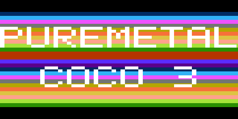
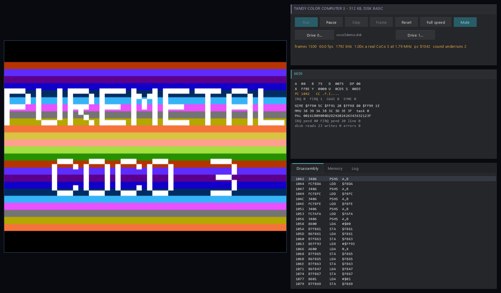

# Tandy Color Computer 3 for the Raspberry Pi Pico series

A Tandy Color Computer 3 emulator for the Raspberry Pi Pico W (RP2040) and Pico 2 W (RP2350), written in
PureMetal and compiled with PureMetalForge to bare-metal machine code - no SDK, no RTOS. It boots Disk
Extended Color BASIC on a 480 x 320 SPI panel at the CoCo 3's own 59.92 frames a second, with the 6809 on
one core and the picture on the other. The same machine also runs as a Windows desktop program.



**No ROMs are included.** The CoCo 3 ROM and Disk BASIC are Tandy's and Microsoft's. You supply your own
copies (see [ROMs](#roms)); the firmware contains none of them. The bundled demo disk holds only a program
written in PureMetal.

## Features

- **The CoCo 3:** the GIME's MMU (8 KB pages, two task sets, ROM modes, the constant $FExx page), every
  GIME text and graphics mode (32-80 columns with attributes, 16-160 bytes a row in 2, 4 and 16 colours,
  192/200/225 lines, palette, border, scroll, horizontal offset), the MC6847-compatible modes CoCo 1 and 2
  software uses, the GIME timer and its interrupts, both PIAs (keyboard matrix with ALT, CTRL, F1, F2,
  joystick comparator, 6-bit DAC, single-bit sound), 0.89 and 1.79 MHz.
- **FD-502 disk:** a WD1793 with four drives - `.DSK` images in the board's flash, written back when BASIC
  saves.
- **The 6809:** the computed-goto core of [6809EmulatorPicoSeries](https://github.com/ajtaji/6809EmulatorPicoSeries),
  Thumb-2 assembly dispatch on the RP2350.
- **Both cores working:** core 0 runs the machine, paced to 59.92 frames a second; core 1 draws each finished
  frame - only the lines whose inputs changed - and streams the rows to the panel by DMA while it draws the
  next line. The renderer's inner loops are Cortex-M33 (Thumb-2) assembly on the RP2350 and Cortex-M0+
  (Thumb-1) assembly on the RP2040, each checked against a plain PureMetal version on silicon.
- **Keyboard** from the PC over the board's USB serial port; a monitor for status, the screen as text, a
  picture capture, full speed and reset.
- **Sound** from the 6-bit DAC and the single-bit output, filtered like the CoCo's own coupling capacitor;
  heard on the desktop version; on a Pico it goes to a Bluetooth speaker in a build that names one.
- **Desktop version** for Windows: the same machine files with 512 KB, `.DSK` files, sound, a debugger view.

## Supported boards

| Board | Firmware | Panel | ROMs and disks | Tested on silicon |
|---|---|---|---|---|
| Raspberry Pi Pico W (RP2040, 200 MHz) | `coco3-pico-w.uf2` | LAFVIN ST7796, SPI 100 MHz | flash | yes |
| Raspberry Pi Pico 2 W (RP2350, 150 MHz) | `coco3-pico2-w.uf2` | LAFVIN ST7796, SPI 75 MHz | flash | built; same code as the two below, not run on a board |
| Raspberry Pi Pico 2 W (RP2350) | `coco3-pico2-w-usb-images.uf2` | LAFVIN ST7796, SPI 75 MHz | sent over USB at boot into SRAM | yes |
| Adafruit Feather RP2350 HSTX | `coco3-feather-rp2350.uf2` | none (the picture over USB) | flash | yes |

The panel is the LAFVIN ST7796 3.5" kit: SCK GP2, MOSI GP3 (SPI0), CS GP5, DC GP6, RESET GP7. The 640 x 240
CoCo picture (borders included) is shown 3:4 horizontally and 4:3 vertically on the 480 x 320 panel. The
SPI clock is at most half the system clock: 100 MHz on a Pico W at 200 MHz, 75 MHz on a Pico 2 W at its
standard 150 MHz (the firmware says so at boot). The RAM given to the CoCo is 128 KB on every Pico; 512 KB
does not fit beside the 6809 core in SRAM.

## Performance

Measured on the boards with the firmware's own status line (`tests/speed.txt`, `tests/demo.txt`,
`tests/p2w_panel.txt`), PureMetalForge 341fd5aca, the 6809 core at 18b0e00:

| | Pico W + panel | Pico 2 W + panel | Feather RP2350 |
|---|---:|---:|---:|
| BASIC on screen, pictures a second | **59.9** | **59.9** | **59.9** |
| core 0 / core 1 busy, BASIC at 0.89 MHz | 21% / 25% | 17-19% / 14-17% | 17% / 14% |
| core 0 / core 1 busy, BASIC at 1.79 MHz | 39% / 23% | 29% / 21% | 36% / 13% |
| the demo (palette rolling, 1.79 MHz), pictures a second | 52-56 | 43-48 | 59.9 |
| unthrottled, 0.89 MHz | 3,585 kHz (4.0x a real CoCo 3) | - | 3,979 kHz (4.4x) |
| unthrottled, 1.79 MHz | 4,490 kHz (2.5x) | - | 4,862 kHz (2.7x) |

The demo changes its colours 30 times a second, and each change rewrites 256 of the panel's 320 rows
(246 KB): every change reaches both panels. On the Pico 2 W the 75 MHz panel wire is the limit (about 85%
busy); on the Pico W it is drawing.

## Quick start

1. **Firmware.** Hold BOOTSEL while plugging the board in, and copy the `.uf2` for your board from
   [`firmware/`](firmware) (or the release assets) onto the drive that appears. Check the download against
   [`firmware/SHA256SUMS.txt`](firmware/SHA256SUMS.txt).
2. **ROMs.** Make the ROM region (see [ROMs](#roms)) and copy its `.uf2` onto the board the same way, or send
   it with PureMetalForge: `PureMetalForge.exe --radio-firmware coco_rom.uf2 --port COM7`.
3. **Disks (optional).** `py -3 tools/make_disk_region.py --drive 0 demo/coco3demo.dsk --drive 1 blank --out disks.uf2`
   and copy or send `disks.uf2` the same way. (Pico 2 W: add `--target rp2350`.)
4. **Keyboard.** `py -3 tools/console.py --port COM7` (the board's USB serial port; needs `pyserial`).
   Typing goes to the CoCo. `Ctrl+]` then a letter is a monitor command: `s` status, `t` the screen as
   text, `c` capture, `f` full speed on/off, `p` CPU registers, `r` reset.
5. At `OK`, try the demo: `LOADM"COCO3DEM":EXEC`.

**Pico 2 W with USB images** (`coco3-pico2-w-usb-images.uf2`, for a board whose flash holds other
firmware's stores): at boot it prints `COCO SEND IMAGES` and waits ten seconds for the ROM region and one
disk. `tools/board.py` sends them: a script whose first line is `images rom_region.bin disk.bin` (the `--bin`
outputs of `make_rom_region.py` and `make_disk_region.py`; see `tests/p2w_panel.txt`). Nothing but the
firmware is written to flash, and disk writes last until the board is reset.

### Flash layout

| Board | Firmware | ROM region (`make_rom_region.py`) | Disks (`make_disk_region.py`) |
|---|---|---|---|
| Pico W | below $50000 | $140000-$14FFFF (`--target rp2040`, the default) | $150000-$1EFFFF, four slots of $28000 |
| Pico 2 W | below $50000 | $3E0000-$3EFFFF (`--target rp2350 --offset 0x3E0000`) | $300000-$39FFFF (`--target rp2350`) |
| Feather RP2350 | below $40000 | $4A2000-$4BFFFF (`--offset 0x4A2000`) | one slot at $6B5000 (`--offset 0x6B5000`) |

The firmware ends below $50000 so that a game store kept from $50000 by other firmware on the same board
survives; the last flash sector is left for a Bluetooth link key.

## ROMs

You need the CoCo 3's internal ROM (32 KB, `coco3.rom`) and the Disk BASIC 1.1 cartridge ROM (8 KB,
`disk11.rom`), from your own CoCo 3 and FD-502, or another copy you are entitled to use. They are checked
against the SHA-1s MAME lists (`coco3.rom` e0d82953..., `disk11.rom` 10bdc5aa...).

- From ROM files: `py -3 tools/make_rom_region.py --rom coco3.rom --cart disk11.rom --out coco_rom.uf2`
  (add `--target rp2350 --offset 0x3E0000` for a Pico 2 W, `--bin rom_region.bin` for the USB-images build).
- From an assembly source of them you are entitled to use (for example a clone of the `coco_roms`
  disassembly project): `tools\build_roms.ps1 -Source <that clone>` assembles them with its a09 assembler,
  refuses any ROM whose SHA-1 is not the expected one, and writes the ROM region.

The region carries CRC-32s; the firmware checks them at every boot and says what is wrong in plain words
if anything is. The text font is read from your ROM (the HPRINT glyphs) - none is in the firmware.

## Building from source

Requires PureMetalForge (341fd5aca or later) and Python 3 with `pyserial`. Clone
[6809EmulatorPicoSeries](https://github.com/ajtaji/6809EmulatorPicoSeries) beside this repository.

```powershell
tools\build.ps1 -Compiler <PureMetalForge.exe>                                   # Pico W -> firmware\coco3-pico-w.uf2
tools\build.ps1 -Compiler <PureMetalForge.exe> -Source rp2350\coco3.pico2w      # Pico 2 W -> firmware\coco3-pico2-w.uf2
tools\build.ps1 -Compiler <PureMetalForge.exe> -Port COM7 -Script tests\basic_boot.txt   # build, upload, run a test
```

`tools/build.ps1` builds, checks where the image ends, and can upload it and run a `tools/board.py` script
against the board. `tools/bench.ps1` runs several builds and scripts in one go. Wrappers: `rp2040/coco3.picow`,
`rp2350/coco3.pico2w`, `rp2350/coco3_usbimages.pico2w`, `rp2350/coco3_feather.pico2w`; the machine itself is
in `src/`.

## The desktop version



The same CoCo 3 for Windows, in PureBasic, drawn with the
[Neon Arcade Display Engine](https://github.com/ajtaji/Neon-Arcade-Dispay-Engine): the machine files in
`src/` compiled unchanged with a PC host layer (`desktop/host.pbi`) and the 6809 core's desktop build. The PC
gives the CoCo 512 KB, and the drives are `.DSK` files. Clone the engine and 6809EmulatorPicoSeries beside
this repository.

```powershell
& "C:\Program Files\PureBasic\Compilers\pbcompilerc.exe" desktop\CoCo3.pb /EXE build\CoCo3.exe /THREAD /DPIAWARE
build\CoCo3.exe --rom <coco3.rom> --cart <disk11.rom>
build\CoCo3.exe --rom <coco3.rom> --cart <disk11.rom> --disk0 demo\coco3demo.dsk --type 'LOADM\qCOCO3DEM\q:EXEC\n'
tools\desktop_check.ps1 -Rom <folder with coco3.rom and disk11.rom>
```

ROMs default to a `roms` folder beside `CoCo3.exe`. The window shows the CoCo's screen, the 6809's and the
GIME's registers, the MMU and palette, a disassembly, memory, the log and the drives. Typing goes to the
CoCo (arrows, Esc = BREAK, Home = CLEAR, F1, F2); F5 run/pause, F10 one instruction, F11 one frame, F3
reset, F8 full speed, F9 mute. `--log N` runs N frames without a window and prints the screen as text;
`--type` and `--type-file` type into the CoCo (`\n` is ENTER, `\q` a quote); `--shot file.png N` saves the
window after N frames; `--wav file.wav` records the sound.

## The PureMetal demo

[`demo/coco3demo.coco3`](demo/coco3demo.coco3) is a PureMetal program for the CoCo 3 itself, built with
PureMetalForge's "Tandy Color Computer 3 (Disk BASIC)" board into [`demo/coco3demo.dsk`](demo/coco3demo.dsk):
a 320 x 192 x 16 GIME picture held in a PureMetal array, a title in large letters, colour bands rolling up
the screen (the palette rotated inside the vertical blank), and a tune on the 6-bit DAC played from the
GIME's fast timer on FIRQ. `LOADM"COCO3DEM":EXEC`.

## Testing

Every test runs on the boards through `tools/board.py` (scripts in `tests/`):

- `basic_boot` - Disk Extended Color BASIC boots to `OK` and runs a typed program;
- `timer` - BASIC's own 10-second TIMER loop counts 910, the same on the Pico W, the RP2350 and the PC;
- `speed` - paced and unthrottled rates at both CPU speeds;
- `demo`, `demo_feather`, `p2w_panel` - the demo LOADed from disk, the panel's rate, both cores' busy shares;
- `disk`, `disk_persist` - SAVE, LOAD and RUN on a flash disk, kept through a reflash;
- `video_modes` - every video mode drawn by a diagnostic build and captured (byte-identical pictures);
- `vcheck`, `vcheck_picow` - a check build (`tools/vcheck_build.py`) that runs the assembly renderer and the
  PureMetal renderer on every call with the same inputs and counts differences: 0 on both chips.

`tools/desktop_check.ps1` runs the desktop checks (boot, TIMER, a disk saved and loaded in a second session).

## Known limits

- Cassette, RS-232, cartridge auto-start and joystick hardware are not emulated.
- 128 KB of CoCo RAM on the Picos (512 KB on the desktop).
- Sound on a Pico needs a Bluetooth speaker named in a private build (`src/audio_bt.pmi`); the public
  firmware is silent. The Bluetooth path has not been run end to end.
- The flash-layout Pico 2 W firmware has not been run on a board (the USB-images build and the Feather
  build, which share its code, have).
- On the Pico 2 W a picture that changes most of its rows is limited by the 75 MHz panel wire.

## Licence

MIT - see [LICENSE](LICENSE). Copyright (c) 2026 ajtaji.

## Credits

- The GIME colour table and the hardware behaviour follow MAME's `gime.cpp`, `coco3.cpp` and `coco.cpp`
  (BSD-3-Clause, Nathan Woods): [licenses/MAME-BSD-3-Clause.txt](licenses/MAME-BSD-3-Clause.txt). No MAME
  code is compiled into the firmware.
- The 6809 core: [6809EmulatorPicoSeries](https://github.com/ajtaji/6809EmulatorPicoSeries).
- The desktop window: [Neon Arcade Display Engine](https://github.com/ajtaji/Neon-Arcade-Dispay-Engine).
